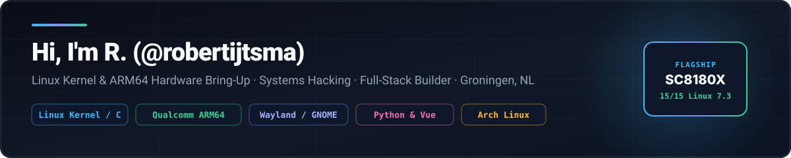

  
  
  

### Featured Project

#### [`surface-pro-x-sq2-linux`](https://github.com/robertijtsma/surface-pro-x-sq2-linux) — 100% Linux 7.3 Enablement for Microsoft Surface Pro X SQ2 (`SC8180X` / ARM64)

Reverse-engineering, kernel patching, Device Tree bring-up, and user-space daemons bringing **all 15 hardware subsystems** of the Qualcomm SC8180X Surface Pro X SQ2 to life on Arch Linux ARM64 (`7.3.1-1-surface`):

| Area | Highlights |
|---|---|
| **Cameras & IR Face ID** | Front 5 MP (`OV5693`), Rear 13 MP (`OV13858`), Front IR (`OV7251`) on Titan 175 CAMSS, symmetric Adreno `DebayerEGL` CCMs, refcounted privacy LEDs, 850 nm IR strobe & ~0.9 s Windows Hello Howdy unlock |
| **Surface Slim Pen 2** | Native `<1 s` BLE auto-reconnect (`Privacy = device` + Local IRK + `0xFFF4` BLE-LC), real-time `UsagePage 0x0E` tactile haptics over `7.5 ms` BLE, white hover-dot GNOME extension & Mutter 51.1 `#5215` crash guard |
| **4G LTE & 4K Video** | Snapdragon X24 + Qualcomm `IPA v4.1`, EL1 SCM (`0x02001a01`) SPI NOR `modem_fsg` extractor (`sq2_fsg_read`), and bit-exact 4K H.264/HEVC/VP9 decode via Qualcomm Venus HFI4 (`PAS 9`) |
| **Power, Display & Security** | Adreno 685 fixes, dual USB-C DisplayPort Alt Mode (`surface_typec`), `surface_ldoe14_xob` audio rail, QSEE hardware TPM 2.0, SLPI sensors, `TCS3430` ALS, and `s2idle` deep sleep + `sq2_s2idle_pm` |

> **Interactive Docs & Quick Install:** [robertijtsma.github.io/surface-pro-x-sq2-linux](https://robertijtsma.github.io/surface-pro-x-sq2-linux/)

---

### Focus & Toolbox

- **Low-Level & Systems**: Linux Kernel (`C`, Device Tree, DKMS, V4L2/CAMSS, DRM/MSM, RPMh, HID/BLE HOGP, QMI/QRTR, TrustZone SCM)
- **Desktop & Automation**: Arch Linux ARM64, GNOME Shell / Wayland (GJS, GTK4, Libadwaita), `systemd`, `libcamera`, PipeWire
- **App & Web Engineering**: Python, TypeScript / JavaScript, Vue, Electron, Shell

---

### Other Repositories

- [`aarch64-arch-mkimg`](https://github.com/robertijtsma/aarch64-arch-mkimg) — Arch Linux AArch64 bootable disk image builder adapted for Surface Pro X
- [`elnosso.dev`](https://elnosso.dev) — Personal site & experiments
